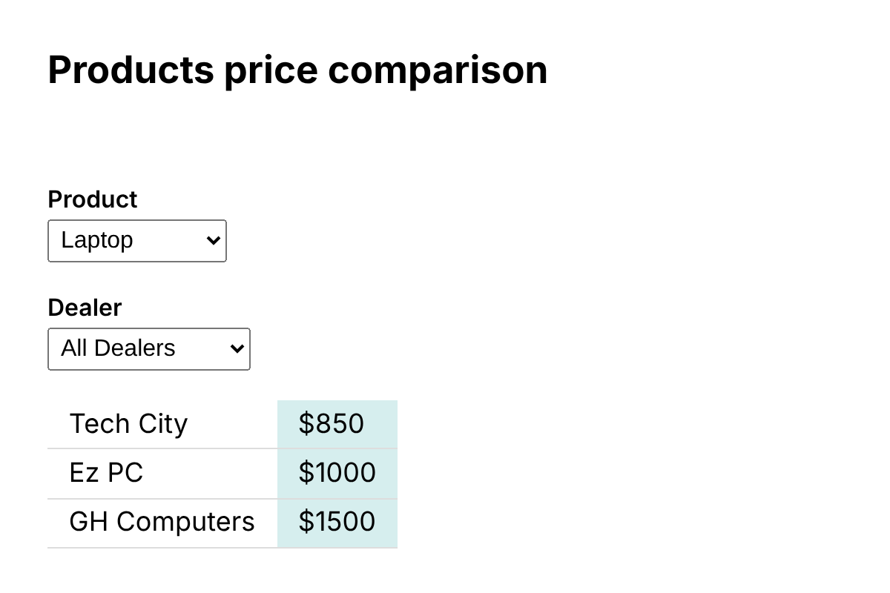
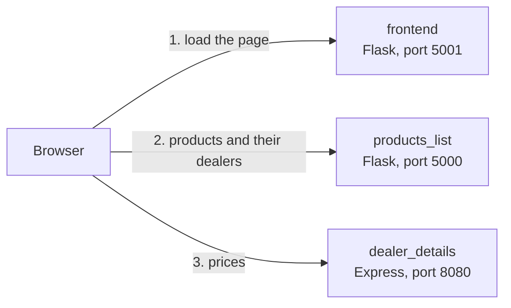

# Product Price Comparison

A small web application that compares the price of a product across several dealers. It is split into three services (a product catalogue API, a dealer pricing API and a web frontend) that run in separate containers and can be deployed independently: locally with Docker Compose, or to IBM Cloud Code Engine.



## How it works

Pick a product, then either a single dealer or **All Dealers**. The page shows the matching prices.



The frontend service only serves the page. Once it has loaded, the browser calls the two APIs directly (both allow cross-origin requests). That is why the frontend has to be told the URLs of the APIs, and why those URLs must work from the visitor's browser: see [Configuration](#configuration).

| Service | Folder | Stack | Port | Data |
| --- | --- | --- | --- | --- |
| Product catalogue API | [`dealer_evaluation_backend/products_list`](dealer_evaluation_backend/products_list) | Python, Flask | 5000 | `products.json` |
| Dealer pricing API | [`dealer_evaluation_backend/dealer_details`](dealer_evaluation_backend/dealer_details) | Node.js, Express | 8080 | `utils/dealers.json` |
| Frontend | [`dealer_evaluation_frontend`](dealer_evaluation_frontend) | Python, Flask, Jinja, axios | 5001 | none |

There is no database: the data lives in the two JSON files.

## Quick start (Docker Compose)

You need Docker with Compose v2 (the `docker compose` command; Docker Desktop includes it). No account or registration is required.

```bash
git clone https://github.com/Vladyslav1389/Product-price-comparison-application.git
cd Product-price-comparison-application
docker compose up --build
```

Open <http://localhost:5001>. Press `Ctrl+C` to stop, and run `docker compose down` to remove the containers.

To run a service without Docker, or to call the APIs directly, see the [backend README](dealer_evaluation_backend/README.md) and the [frontend README](dealer_evaluation_frontend/README.md).

## Configuration

Everything is configured with environment variables; nothing needs editing in the source.

| Variable | Used by | Default | Meaning |
| --- | --- | --- | --- |
| `PROD_LIST_URL` | frontend | `http://localhost:5000` | Base URL of the product catalogue API, as seen **from the browser**. |
| `DEALER_DETAILS_URL` | frontend | `http://localhost:8080` | Base URL of the dealer pricing API, as seen **from the browser**. |
| `PORT` | dealer_details | `8080` | Port the Express server listens on. |

`docker-compose.yml` sets the two frontend variables to `localhost` URLs. Docker service names such as `http://products-backend:5000` would not work here, because it is the browser, not the frontend container, that makes the requests. When the services are deployed to the cloud, these must be the public `https://` URLs of the deployed APIs.

## Deploying to IBM Cloud

[`docs/cloud-deployment.md`](docs/cloud-deployment.md) is a step-by-step guide to deploying all three services to IBM Cloud Code Engine. It needs an IBM Cloud account (the guide explains what that involves and what it costs), and it does not rely on anything that only exists inside IBM's lab environment.

> **Status:** the commands follow IBM's documentation but have **not yet been run end-to-end by the author**. Last verified: _not yet_.

## Repository layout

```text
.
├── docker-compose.yml
├── docs/
│   ├── cloud-deployment.md
│   └── screenshot.png
├── dealer_evaluation_backend/
│   ├── README.md                 API reference and how to run each backend
│   ├── products_list/            Flask service, products.json
│   └── dealer_details/           Express service, utils/dealers.json
└── dealer_evaluation_frontend/
    ├── README.md                 how the page gets its configuration
    ├── app.py                    Flask app that serves the page
    └── html/index.html           the page (Jinja template + JavaScript)
```

## Troubleshooting

- **"port is already allocated" or "address already in use" on 5000.** On macOS, the AirPlay Receiver uses port 5000. Turn it off in System Settings, or change the left-hand number of `"5000:5000"` in `docker-compose.yml` (and `PROD_LIST_URL` to match).
- **The product list stays empty or the page shows "Could not load...".** Check that both APIs are running and open in the browser, for example <http://localhost:5000/products>. The page also loads axios from a CDN, so the browser needs internet access.

## Known limitations

- Data is read from static JSON files, so there is no way to change prices at runtime.
- The services run on the Flask development server and plain Express, without authentication, rate limiting or restricted CORS. That is fine for a demo, not for production.
- The APIs answer "not found" with HTTP 200 and a `message` field, not with a 404.
- There are no automated tests or CI yet.
- The Docker base images (`python:3.8`, `node:18`) are past end of life. Upgrading them is the next planned change.

## Background and credits

This project started from the capstone lab of an IBM Skills Network course, which provided the original three-service application and the idea of deploying it to IBM Cloud Code Engine. I have since changed it:

- the service URLs come from environment variables, instead of being edited into `index.html` before every deployment;
- the frontend was rewritten with error handling, URL-encoded requests and safe rendering of API data;
- the backends were hardened (file paths no longer depend on the working directory, and product names such as `constructor` are handled correctly);
- the Docker Compose setup and all documentation are new.

## License

Licensed under the [Apache License 2.0](LICENSE). The original work is copyright IBM Developer Skills Network (2020) and that notice is kept in the license file, as the license requires.
